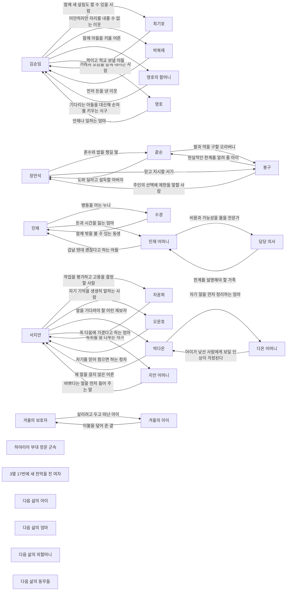
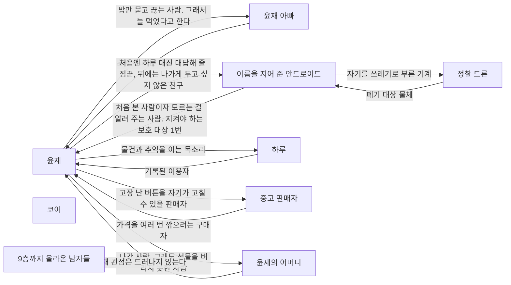
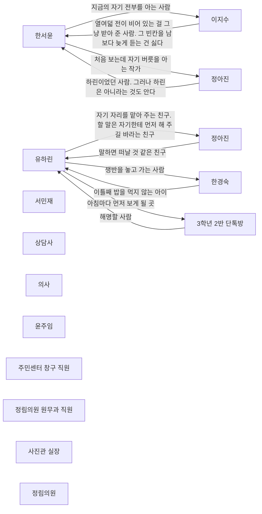
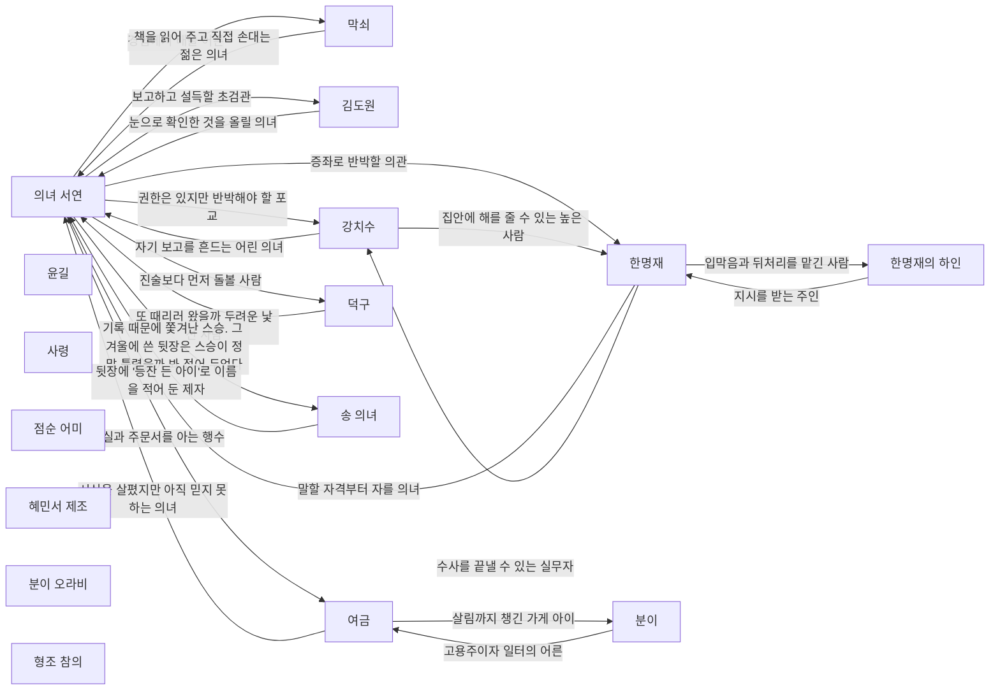

# 작품별 인물 관계

작가용 관계도. 화살표는 상대를 보는 시선이며 모든 간선이 실제 대화를 뜻하지는 않는다.

## 360

[인물 카드·관계 원본](360.yaml)

## 8bit-heart

[인물 카드·관계 원본](8bit-heart.yaml)

## erase

[인물 카드·관계 원본](erase.yaml)

## muwon

[인물 카드·관계 원본](muwon.yaml)

